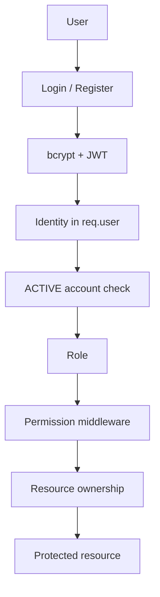
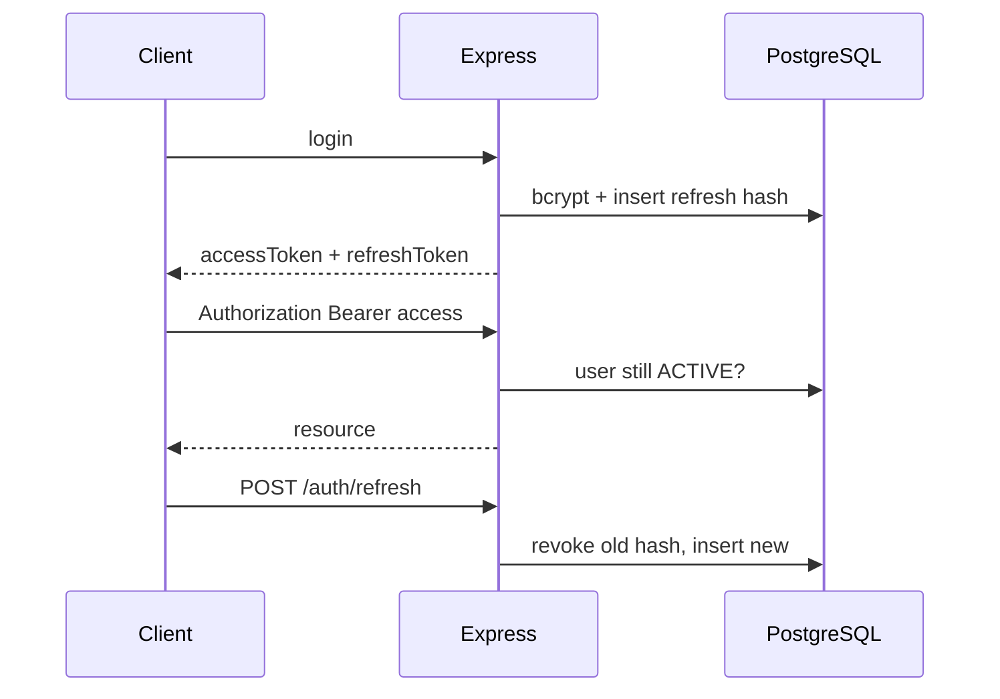

# Authentication and RBAC

Status: **CURRENT** unless marked **PARTIAL** or **FUTURE**.

Runtime authorization is the in-code matrix in `backend/src/utils/permissions.ts`.
The `role_permissions` table is a seed mirror only.

---

## 1. Authentication architecture

| Step | Implementation |
| --- | --- |
| Register | `POST /api/auth/register` → always PASSENGER |
| Login | `POST /api/auth/login` → access + refresh JWT |
| Logout | `POST /api/auth/logout` → revoke all refresh hashes |
| Refresh | `POST /api/auth/refresh` → rotate (old row revoked) |
| Me | `GET /api/auth/me` |
| Change password | `POST /api/auth/change-password` |
| Password reset | **FUTURE** (not implemented) |
| Email verification | **NOT REQUIRED** / not implemented |

Passwords: bcryptjs, cost 12. Never stored plaintext. Never returned.

Tokens: HS256 access (`JWT_EXPIRES_IN`, default 8h) and refresh (`JWT_REFRESH_EXPIRES_IN`, default 7d). Refresh stored as SHA-256. Web client keeps tokens in `localStorage` (Phase 02 decision — Flutter + simulator + Socket.IO use Bearer).

---

## 2. Login flow

1. Validate email + password  
2. Lookup user by lowercase email  
3. Missing, soft-deleted, or not ACTIVE → `401 Invalid email or password` (same message)  
4. bcrypt compare  
5. Update `lastLoginAt`, issue token pair  

Rate limit: **30 / 15 min / IP** on all `/api/auth/*`.

---

## 3. Registration flow

Public body: email, password (8–72, letter + number), fullName, optional phone.

`role` in the body is **ignored**. Account is always PASSENGER + passenger profile.

Privileged roles are assigned only by `users.manage` (`PUT /api/users/:id/roles`).

---

## 4. Token / session flow

Deactivate / archive revokes refresh tokens. Access tokens are rejected on the next request because middleware re-reads `users.status`.

---

## 5. Password security

- Algorithm: bcryptjs (unchanged; existing hashes remain valid)  
- Logger redacts password / token / jwt / secret keys  
- Change-password requires current password, then rotates tokens  
- Password reset / email OTP: **FUTURE**

---

## 6. Role architecture

SUPER_ADMIN · GOVERNMENT · BRTA · POLICE · TRANSPORT_OWNER · DRIVER · PASSENGER

Account status enum (unchanged): ACTIVE · INACTIVE · SUSPENDED.

---

## 7. Permission architecture

Authoritative: `ROLE_PERMISSIONS`. Middleware: `requirePermission` / `requireAnyPermission`.

Do not edit only `role_permissions` and expect API behavior to change.

---

## 8. Resource ownership

| Actor | Rule |
| --- | --- |
| Passenger | Own SOS/complaints/favorites/`/auth/me`. Public GPS DTO. |
| Driver | Own trips (`trips.own`). Cannot list users or analytics. |
| Owner | Company scoped via `ownerUserId`. Cannot read another company's bus/driver/trip/route. Can manage own routes (`routes.manage`). |
| Police | SOS/alerts manage. No `users.manage`. |
| BRTA | Verification reads. No SOS dispatch. |
| Government | Oversight reads + SOS manage. No user admin. |
| Super Admin | User/role admin. Cannot remove the last active Super Admin. |

Identity always comes from the verified JWT + live ACTIVE check. Client `user_id` / `role` / `owner_id` are not trusted.

---

## 9. Frontend route protection

`AppShell` requires a session and an allowed role before rendering children. Wrong-role URLs redirect to `homeFor(roles)`.

This is UX only. The API remains authoritative. Next.js cannot read `localStorage` in edge middleware, so URL typing is blocked in the client shell, not by a server cookie gate.

---

## 10. Backend API protection

Order: helmet/CORS → rate limit → route → `authRequired` (JWT + ACTIVE) → permission → ownership → handler.

Public: `/health`, `/api/auth/login|register|refresh`, public GPS/routes, `/api/gps/source-mode`.

---

## 11. Socket.IO authorization

Missing/invalid token → anonymous, `public:buses` only.

`canJoinSocketRoom` allows `public:buses`, `role:{own role}`, `user:{own id}` only.

Operational events (`bus:location:ops`, `alert:new`, `sos:new`) are emitted to role rooms, not to passengers.

---

## 12. Privilege escalation prevention

- Public register cannot set a role  
- `PUT /users/:id/roles` requires `users.manage`  
- Last active Super Admin cannot be demoted, deactivated, or archived  
- Deactivation revokes refresh tokens and fails subsequent Bearer use  

---

## 13. Security limitations

- JWT in `localStorage` (XSS)  
- No password-reset email flow  
- Access JWT is not denylisted; ACTIVE check covers deactivation  
- Frontend route guard is client-side  
- Shared demo password in seed  

---

## 14. Future improvements

- httpOnly cookie session for web only  
- Password reset  
- Access-token denylist / shorter TTL  
- Admin user-management UI (API exists)  
- Server-side Next middleware after cookie migration  
