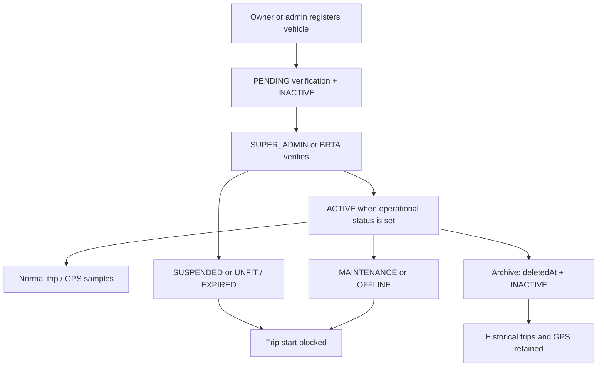

# Bus registration and vehicle management

Status labels used below:

- **CURRENT** — implemented in this repository
- **SIMULATED** — stored or decided in the app, not a live government/hardware feed
- **FUTURE** — not implemented; do not treat as available

This module uses the existing `Bus` model and `/api/buses` API. There is no separate `/api/vehicles` resource.

---

## 1. Vehicle module overview

Nirapad Transit registers and manages public-transport vehicles (buses and related types) for demo operators in Bangladesh. The lifecycle is:

Registration → owner/operator association → **manual / simulated** verification → operational status → optional route/driver assignment → GPS via trips → archive (inactive), not hard delete.

**CURRENT:** CRUD-style management on `/api/buses`, role-aware DTOs, owner scoping, BRTA/admin verification, trip-start eligibility checks.

**NOT CLAIMED:** production-ready national registry, live BRTA integration, physical GPS hardware, or trained AI.

---

## 2. Vehicle lifecycle

**CURRENT:** New vehicles start `registrationStatus=PENDING`, `fitnessStatus=PENDING`, `insuranceStatus=NONE`, `operationalStatus=INACTIVE`.

**SIMULATED:** Fitness, registration, and insurance/token fields are staff-entered. They are not fetched from BRTA.

---

## 3. Vehicle data model

Existing Prisma `Bus` fields are used. No Phase 05 schema migration was required.

| Field | Role |
| --- | --- |
| `registrationNo` | Unique vehicle registration number |
| `vehicleType` | STANDARD_BUS, MINIBUS, AC_BUS, DOUBLE_DECKER, ARTICULATED |
| `manufacturer`, `model`, `yearOfManufacture` | Optional vehicle description |
| `capacity` | Seating capacity (API: 8–80) |
| `companyId` | Transport owner / operator |
| `routeId`, `driverId` | Current assignment only |
| `fitnessStatus` | FIT / UNFIT / EXPIRED / PENDING — **SIMULATED** |
| `registrationStatus` | ACTIVE / EXPIRED / SUSPENDED / PENDING — **SIMULATED** |
| `insuranceStatus` | VALID / EXPIRED / NONE — **SIMULATED** tax/token-style field |
| `operationalStatus` | ACTIVE / INACTIVE / MAINTENANCE / OFFLINE |
| `deletedAt` | Soft archive. Hard delete is not offered. |

There is no `RETIRED` enum. **CURRENT** mapping: `OFFLINE` is the retired/out-of-service operational state.

Indexes already present: unique `registrationNo`, `companyId`, `routeId`, `operationalStatus`.

---

## 4. Registration workflow

1. Authenticated `TRANSPORT_OWNER` or `SUPER_ADMIN` (`buses.manage`) submits `POST /api/buses`.
2. Backend validates registration number, type, and capacity.
3. Owner `companyId` is taken from the signed-in owner's company. Body `companyId` is ignored for owners.
4. Admin must supply a real `companyId`.
5. Vehicle is created unverified and inactive.
6. Audit action `bus.create` is written (no secrets).

**CURRENT:** Registration number is normalized (trim, uppercase, spaces → `-`) and must match `[A-Z0-9][A-Z0-9-]{3,30}[A-Z0-9]`.

---

## 5. Ownership model

`TRANSPORT_OWNER` → `TransportCompany` → `Bus`.

| Actor | Scope |
| --- | --- |
| Transport owner | Own company only: list, create, update allowed fields, status, archive |
| Super admin | All operators; may change `companyId` (logged as `bus.ownership`) |
| Driver | Assigned vehicles only (`bus.driverId`) |
| Passenger | Public-safe fields |
| Police | Safety-oriented fields (no insurance/token, no GPS device, no driver phone) |
| Government | Nationwide read |
| BRTA | Nationwide read + `buses.verify` |

Owner A cannot read, update, delete, or take ownership of Owner B's vehicles.

---

## 6. Verification workflow

**SIMULATED / MANUAL.** Label returned on list/detail payloads: `MANUAL / SIMULATED VERIFICATION`.

Possible stored states (existing enums, not a new status system):

- Registration: PENDING, ACTIVE, EXPIRED, SUSPENDED
- Fitness: PENDING, FIT, UNFIT, EXPIRED
- Insurance/token: NONE, VALID, EXPIRED

`PATCH /api/buses/:id/verification` requires `buses.verify` (**CURRENT:** `SUPER_ADMIN`, `BRTA`).

Owners cannot set verification fields via PUT or PATCH.

**FUTURE:** Live BRTA / government API checks, document upload, inspector workflows.

---

## 7. Status workflow

Operational status (**CURRENT** enum):

| Status | Meaning |
| --- | --- |
| ACTIVE | Eligible for a normal trip only if also verified |
| INACTIVE | Not in service |
| MAINTENANCE | Workshop / not available |
| OFFLINE | Treated as retired / out of service for trip start |

A normal trip may start only when:

- not archived
- `operationalStatus === ACTIVE`
- `registrationStatus === ACTIVE`
- `fitnessStatus === FIT`

Suspended, expired, pending, maintenance, inactive, and offline vehicles receive `409` on `POST /api/trips/start`.

Historical trips and GPS rows are not deleted when status changes.

Owners cannot set ACTIVE until the vehicle is verified.

---

## 8. API endpoints

All under the existing fleet prefix (default `/api`).

| Method | Path | Permission |
| --- | --- | --- |
| GET | `/buses` | `buses.read` — paginated, filtered, sorted |
| POST | `/buses` | `buses.manage` |
| GET | `/buses/:id` | `buses.read` + ownership / assignment |
| PUT | `/buses/:id` | `buses.manage` + ownership |
| PATCH | `/buses/:id/status` | `buses.manage` + ownership |
| PATCH | `/buses/:id/verification` | `buses.verify` |
| DELETE | `/buses/:id` | `buses.manage` — **archive only** |

Query params for list: `page`, `pageSize` (max 100), `q`, `operationalStatus`, `registrationStatus`, `fitnessStatus`, `vehicleType`, `companyId` (admin), `sortBy`, `sortDir`.

---

## 9. Permission rules

Runtime source: `backend/src/utils/permissions.ts`.

| Permission | Roles |
| --- | --- |
| `buses.read` | All seeded roles that already had fleet visibility |
| `buses.manage` | SUPER_ADMIN, TRANSPORT_OWNER |
| `buses.verify` | SUPER_ADMIN, BRTA |

Passengers, drivers, police, and government cannot register vehicles.

Frontend route allow-lists do not replace API checks.

---

## 10. Security rules

- Authentication required on all bus endpoints.
- Owner identity comes from the session company, not from a trusted `owner_id` / `companyId` body field.
- Privileged fields (verification, foreign `companyId`, GPS device bind) are rejected for owners.
- Responses use role-specific DTOs. No password hashes, tokens, GPS device records, or driver phone numbers on passenger/police projections.
- Duplicate `registrationNo` → 409.
- Invalid payload → 422.
- Hard delete is not implemented because GPS history is `RESTRICT` on bus and trips/SOS/complaints must remain.

---

## 11. GPS relationship

**CURRENT:** `Bus` → `Trip` → `GpsLocation` / `GpsLatestLocation`. Ingest remains simulation-capable as in Phases 02–03.

A retired/suspended/unverified vehicle cannot start a **new normal trip**. Existing GPS history stays readable to authorized roles.

**NOT CLAIMED:** physical tracker hardware or a live national GPS network.

---

## 12. Current limitations

- Verification is staff-entered (**SIMULATED**).
- `OFFLINE` stands in for retired; there is no separate RETIRED enum.
- Route and driver assignment are current-pointer fields plus assignment history tables. Full driver verification is Phase 06. Full route compliance is Phase 08.
- Public passenger list is public-safe, not a complete national timetable.
- No vehicle document store, no tax token file upload.

---

## 13. Future BRTA integration

**FUTURE** only:

- Official registration / fitness / tax token APIs
- Inspector accounts beyond the demo BRTA role
- Certificate document verification
- Automatic suspension from a government source

Until then, every verification UI and API message must remain labeled **MANUAL / SIMULATED VERIFICATION**.
