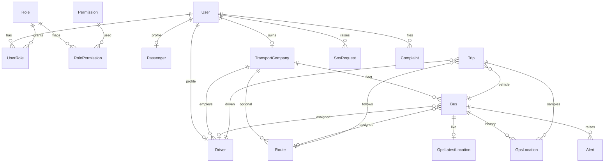

# Database architecture

Status labels: **CURRENT** · **PARTIAL** · **FUTURE**

PostgreSQL 16 with Prisma 6. Schema: `backend/prisma/schema.prisma`.
Migrations: `backend/prisma/migrations/`. Display timezone Asia/Dhaka; timestamps stored UTC.

This is a **demo / simulation** dataset. It is not a national registry, not a BRTA extract, and not hardware GPS.

---

## 1. Database overview

---

## 2. Entity list

| Entity | Table | Status |
| --- | --- | --- |
| User | users | CURRENT |
| Role | roles | CURRENT |
| Permission | permissions | CURRENT |
| Role permission | role_permissions | CURRENT (seed mirror, not runtime auth) |
| User role | user_roles | CURRENT |
| Passenger | passengers | CURRENT |
| Driver | drivers | CURRENT |
| Transport owner / operator | transport_companies + ownerUserId | CURRENT |
| Bus / vehicle | buses | CURRENT |
| GPS device | gps_devices | CURRENT (simulator serials) |
| Route | routes | CURRENT |
| Route stop | route_stops | CURRENT |
| Trip | trips | CURRENT |
| GPS history | gps_locations | CURRENT |
| Latest GPS | gps_latest_locations | CURRENT |
| SOS | sos_requests | CURRENT |
| Alert | alerts | CURRENT |
| Complaint | complaints | CURRENT |
| Notification | notifications | CURRENT |
| Audit log | audit_logs | CURRENT |
| Accident | accidents | PARTIAL (table exists, unused in seed) |
| Violation | violations | CURRENT (written by GPS rules) |
| Analytics snapshot | analytics | PARTIAL (table unused; live counts in API) |
| Lost & Found | — | FUTURE (not in schema) |
| System setting | system_settings | CURRENT |

---

## 3. ER relationship explanation

- Identity: User 1—N Role via `user_roles`. Role N—N Permission via `role_permissions`.
- Operator: TransportCompany 1—N Bus, Driver, Route. Optional 1—1 owner User.
- Assignment: Bus optionally points at current Route and Driver. History tables `bus_assignments` / `driver_assignments` record changes.
- Operations: Trip requires Bus + Driver + Route. GPS history optionally links Trip; latest GPS is 1—1 on Bus.
- Safety: SOS belongs to User; optional Bus/Trip (SET NULL). Complaint belongs to User; optional Bus/Driver (SET NULL). Alerts optional Bus/Driver/Trip/Route (SET NULL).
- Platform: Notification CASCADE with User. AuditLog keeps the row if the user is removed (optional userId).

---

## 4. User / RBAC model

Seven `RoleCode` values: SUPER_ADMIN, GOVERNMENT, BRTA, POLICE, TRANSPORT_OWNER, DRIVER, PASSENGER.

**Runtime authorization (Phase 02):** `ROLE_PERMISSIONS` in application code.

**Database `role_permissions`:** seeded to match code for documentation / a future admin editor. Changing the table does not change API access.

Uniques: `users.email`, `users.phone`, `roles.code`, `permissions.code`, composite `(userId, roleId)`, `(roleId, permissionId)`.

---

## 5. Vehicle / driver model

Bus: unique `registrationNo`, required `companyId`, optional route/driver/device, fitness/registration/insurance enums, `operationalStatus`, soft `deletedAt`.

Driver: unique `userId` and `licenseNumber`, optional `companyId`, license status/expiry, `nidReference` (demo redacted), performance counters. Assigned vehicle is `Bus.driverId` (current) plus `driver_assignments` (history).

Sensitive: `passwordHash` is never returned by user list/detail APIs. `nidReference` is not in the passenger projection.

---

## 6. Route / trip model

Route: unique `code`, origin/destination names + coordinates, `polyline` JSON, `allowedSpeed`, city, optional company, `isDemo`, soft delete. Stops: unique `(routeId, sequence)`.

Trip: bus + driver + route, status, start/end times and coordinates, speeds, `dataSource`. One active trip per bus/driver is enforced in the **start API**, not by a unique index (PostgreSQL cannot express `UNIQUE (busId) WHERE status = IN_PROGRESS` in Prisma). Overlapping trips are therefore an application constraint.

---

## 7. GPS model

| Table | Role |
| --- | --- |
| gps_latest_locations | One row per bus (PK = busId). Live map / nearby / ETA |
| gps_locations | Append-only history. 29k+ rows already in the demo DB |

Fields: lat/lng (`Decimal(10,7)`), speed, heading, timestamp, optional device/trip/route/driver, `source` (`SIMULATION` default).

Ingest validates lat −90..90 and lng −180..180 in Zod. Current rows have no out-of-range coordinates.

History `busId` is **RESTRICT** — hard-deleting a bus with history fails. Latest location **CASCADE** with the bus (snapshot only). Soft-delete the bus instead.

Nearby: SQL bounding box on latest lat/lng, then haversine refine. No PostGIS. Acceptable at current fleet size (16 buses).

Retention: documented in `docs/gps-retention.md`. No automatic delete.

Source in this project: **SIMULATION**. Not hardware GPS.

---

## 8. SOS / emergency model

`sos_requests`: user (required, RESTRICT), optional bus/trip (SET NULL), lat/lng, message, status, timestamps. No responder or priority columns — severity lives on the companion `alerts` row of type SOS.

Hard-deleting a user with SOS is blocked. Soft-delete users instead.

---

## 9. Complaint model

Complainant (`passengerId` → User), category enum, description, optional bus/driver/location/evidence, status, resolution, resolver, timestamps.

Not present: trip, priority, assigned authority. Those are FUTURE / PARTIAL.

---

## 10. Notification model

Recipient, type enum, title, body, JSON payload, `readAt`, `createdAt`. Indexes `(userId, createdAt)` and `(userId, readAt)`. CASCADE on user delete.

---

## 11. Audit log model

Actor (optional), action, entity, entityId, IP, user-agent, JSON metadata, createdAt.

Written by `auditAction` on user/fleet writes and (Phase 03) SOS/alert/complaint status changes. Does not store passwords or tokens.

---

## 12. Index strategy

High-frequency:

- Live: `gps_latest_locations` PK + `(latitude, longitude)` + `timestamp`
- History: `(busId, timestamp)`, `(tripId, timestamp)`, `(routeId, timestamp)`
- Trips: `(busId, startedAt)`, `status`, `driverId`, `routeId`
- Alerts: `(type, status)`, `createdAt`, `busId`
- SOS: `(status, createdAt)`, `userId`, `busId`
- Complaints: `(status, createdAt)`, passenger/bus/driver
- Notifications: user + created/read
- Audit: createdAt, userId, `(entity, entityId)`
- Refresh: `userId`, `tokenHash`

---

## 13. Data retention strategy

| Data | Policy (CURRENT) |
| --- | --- |
| Users, buses, drivers, routes, companies | Soft `deletedAt` + status enums |
| GPS history | Keep; no auto-delete |
| Latest GPS | Upsert in place |
| SOS, complaints, alerts, audit | Retain; SET NULL on optional vehicle links |
| GPS future tiers | See `docs/gps-retention.md` (FUTURE job) |

---

## 14. Current limitations

- No Lost & Found entity
- `analytics` table unused (API computes counts live)
- No DB check constraints for lat/lng (app validation only)
- No partial unique index for one open trip per bus/driver
- `BusAssignment.routeId` / GPS history FKs added in Phase 03; older DBs must `migrate deploy`
- In-memory rate limits / alert cooldowns are not database-backed
- Seed demo password is shared across accounts (development only)
- Not national-scale

---

## 15. Future scalability (FUTURE)

- Monthly partition or archive of `gps_locations`
- Downsample / hot-warm-cold tiers
- Read replica for analytics
- Redis cache for latest locations
- PostGIS only if nearby queries outgrow bbox
- Event streaming for ingest
- Object-storage archive
- Sharding by operator/region

Do not implement these until volume requires them.
