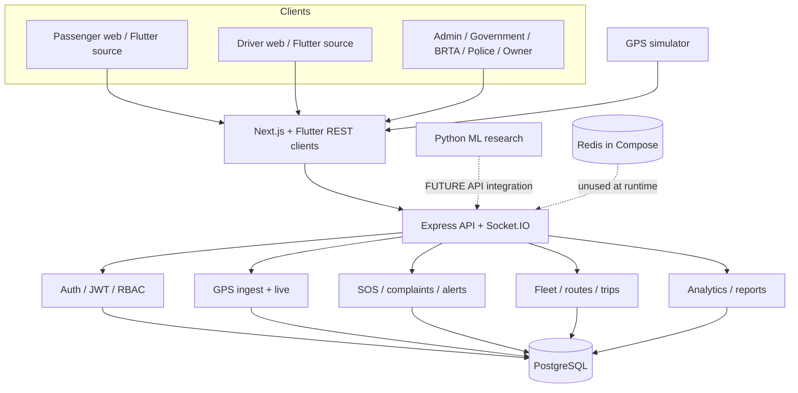
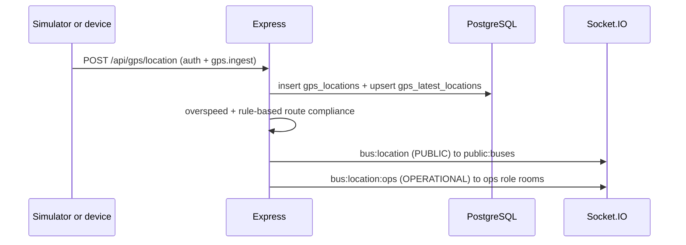
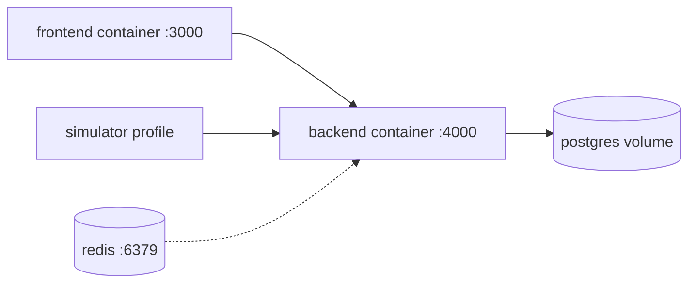

# System architecture

Nirapad Transit as implemented in this repository. Only components that exist
are documented. Items marked **FUTURE** are not implemented.

Status key: **IMPLEMENTED** · **PARTIAL** · **EXPERIMENTAL** · **FUTURE**

---

## 1. High-level architecture

| Layer | Stack | Status |
| --- | --- | --- |
| Web | Next.js 14 App Router, React 18, TypeScript, Tailwind | IMPLEMENTED |
| Mobile | Flutter source in `mobile/lib` only (no android/ios folders) | PARTIAL |
| API | Express 4, TypeScript, Zod | IMPLEMENTED |
| Realtime | Socket.IO (single process, no Redis adapter) | IMPLEMENTED |
| Database | PostgreSQL 16 + Prisma 6 | IMPLEMENTED |
| Auth | JWT access + hashed refresh + code RBAC | IMPLEMENTED |
| Maps | Leaflet + OpenStreetMap | IMPLEMENTED |
| GPS source | Node simulator posting to the API | IMPLEMENTED (SIMULATION) |
| AI/ML | Python scripts on synthetic ETA data | EXPERIMENTAL |
| Ticketing / fare / CCTV / government APIs / hardware GPS | — | FUTURE |

No BRTA, police, or national government API is connected. Demo seed data is not a live registry.

---

## 2. Frontend architecture

- App Router under `frontend/src/app` with role prefixes:
  `/admin`, `/government`, `/police`, `/brta`, `/owner`, `/driver`, `/passenger`
- `AppShell` enforces client-side role allow-lists and redirects to `homeFor(roles)`
- `AuthProvider` loads `/auth/me` only when an access token exists
- `api()` sends `Authorization: Bearer` and refreshes once on HTTP 401
- Tokens live in `localStorage` (`nt_access`, `nt_refresh`) — see Authentication
- Socket.IO client connects with `auth.token` and listens for `bus:location`
- Live maps: `DashboardView` + `LiveMap` (Leaflet)
- Many admin/owner pages are table wrappers around shared `SimplePages` — **PARTIAL** CRUD UI

---

## 3. Backend architecture

Entry: `backend/src/index.ts` → `createApp()` + Socket.IO attach.

| Area | Location | Status |
| --- | --- | --- |
| Middleware | helmet, CORS+credentials, compression, JSON, rate limits, auth, RBAC, Zod, audit, errors | IMPLEMENTED |
| Auth | `auth.service.ts`, `lib/jwt.ts` | IMPLEMENTED |
| Authorization | `utils/permissions.ts` + `middlewares/rbac.ts` | IMPLEMENTED |
| Fleet / routes / trips | `fleet.routes`, `route.routes`, `trip.routes` | IMPLEMENTED |
| GPS | `gps.routes`, `gps.service`, `utils/gpsDto.ts` | IMPLEMENTED |
| SOS / complaints / alerts | `safety.routes` + `alert.service` | IMPLEMENTED (Alert = ops event; SOS workflow Phase 12) |
| Analytics / reports | `analytics.service`, report exporters | IMPLEMENTED (DB counts, owner-scoped; demo-labeled) |
| Validation | Zod per write route | IMPLEMENTED |
| Envelope | `{ success, message, data }` | IMPLEMENTED |

---

## 4. Database architecture

- Schema: `backend/prisma/schema.prisma`
- History: `backend/prisma/migrations/`
- Soft delete: `deletedAt` on users, passengers, drivers, companies, buses, devices, routes
- Timestamps: stored UTC; application display timezone Asia/Dhaka
- GPS: `gps_latest_locations` (one row per bus) + `gps_locations` (append-only history)
- Nearby: bounding-box filter on latest lat/lng, then haversine refine in Node (no PostGIS)
- Indexes include bus/route/trip/alert/SOS/complaint/notification/audit plus latest lat/lng and timestamp

`role_permissions` is seeded and is **not** the runtime authorizer.

---

## 5. Authentication architecture

- Access JWT: `JWT_EXPIRES_IN` (default 8h)
- Refresh JWT: `JWT_REFRESH_EXPIRES_IN` (default 7d), SHA-256 stored, revoked on logout and on refresh (rotation)
- Login/register return `{ user, accessToken, refreshToken }`
- Flutter and the GPS simulator authenticate with the same Bearer contract
- **JWT decision (Phase 02):** keep Bearer tokens in localStorage. A full httpOnly cookie migration would break Flutter, the simulator, and Socket.IO `auth.token` without a large rewrite.
- Residual XSS risk: tokens are readable by script on the web origin
- Logger redacts keys containing password/token/jwt/secret/authorization

---

## 6. RBAC architecture

**Runtime source of truth:** `ROLE_PERMISSIONS` in `backend/src/utils/permissions.ts`.

**Database `role_permissions`:** documentation / future admin editor only. Changing seed rows does not change API access.

| Permission | SUPER_ADMIN | GOVERNMENT | BRTA | POLICE | TRANSPORT_OWNER | DRIVER | PASSENGER |
| --- | --- | --- | --- | --- | --- | --- | --- |
| users.manage / roles.manage / settings.manage / audit.read / simulator.control | yes | | | | | | |
| buses.manage / drivers.manage / trips.manage / routes.manage | yes | | | | yes | | |
| companies.manage / gps.manage | yes | | | | | | |
| buses.read / drivers.read / routes.read | yes | yes | yes | yes* | yes | yes** | yes** |
| companies.read | yes | yes | yes | | | | |
| gps.ingest | yes | | | | | yes | |
| trips.own | yes | | | | | yes | |
| alerts.read | yes | yes | yes | yes | yes | yes | |
| alerts.manage | yes | | | yes | | | |
| sos.create | yes | | | | | yes | yes |
| sos.read / sos.manage | yes | yes | | yes | | | |
| complaints.create | yes | | | | | | yes |
| complaints.read | yes | yes | yes | yes | yes | | yes (own) |
| complaints.manage | yes | | | | | | |
| analytics.read / reports.read | yes | yes | yes | yes | yes | | |
| notifications.read | yes | yes | yes | yes | yes | yes | yes |

\* Police have `buses.read`, `drivers.read`, `routes.read` (no `companies.read`).  
\*\* Driver/passenger `buses.read` / `routes.read` are for assigned/public views; passenger bus detail strips device identifiers.

Owner list/detail mutations are scoped to the company linked by `ownerUserId`.

---

## 7. GPS architecture

| Endpoint | Auth | Payload |
| --- | --- | --- |
| POST /gps/location | Required + `gps.ingest` | Operational DTO |
| GET /gps/live, /nearby, /buses/:id/location | Optional | PUBLIC by default; OPERATIONAL for admin/gov/BRTA/police/owner (owner operational fields only for own company) |
| GET /gps/buses/:id/history | Required + `buses.read` | History rows; non-ops lose device/driver/trip fields |
| GET /gps/buses/:id/eta | Optional | Rule-based prototype |
| GET /gps/source-mode | Public | SIMULATION or DEVICE note |

Never in PUBLIC DTO: deviceId, driverId, tripId, companyId, allowedSpeed, operationalStatus internals.

Current ingest source in this project: **SIMULATION**. Hardware GPS is FUTURE unless `GPS_SOURCE_MODE=DEVICE` and a real feed is configured.

Retention: see `docs/gps-retention.md`. No automatic delete in this phase.

---

## 8. Real-time Socket.IO architecture

| Event | Rooms | Auth |
| --- | --- | --- |
| `bus:location` | `public:buses` (all sockets) | Public DTO |
| `bus:location:ops` | `role:SUPER_ADMIN`, GOVERNMENT, BRTA, POLICE, TRANSPORT_OWNER | Operational DTO |
| `route:status` | SUPER_ADMIN, GOVERNMENT, BRTA, POLICE, `company:{id}` | Auth rooms only |
| `alert:new` | operational roles above | Auth rooms only |
| `sos:new` | SUPER_ADMIN, GOVERNMENT, POLICE | Auth rooms only |
| `notification:new` | `user:{id}` | Auth rooms only |

- Missing token: public bus room only
- Invalid/expired token: treated as anonymous (map still works)
- Client `subscribe` cannot join another user's room or an ungranted role room
- No Redis Socket.IO adapter (single-node only)
- Reconnect: client `autoConnect`; server does not persist missed events

---

## 9. SOS architecture

- `POST /sos` — passenger or driver, rate-limited, `sos.create`
- `GET /sos` — police / government / admin (`sos.read`)
- `PUT /sos/:id/status` — `sos.manage`
- Broadcast `sos:new` to emergency role rooms
- Not a national 999/dispatch integration (FUTURE)

---

## 10. Deployment architecture

- `docker-compose.yml`: db (healthcheck), redis (healthcheck, unused by app), backend, frontend, simulator (`profiles: [sim]`)
- Backend image runs `prisma migrate deploy` then `node dist/src/index.js`
- Compose DB password is `nirapad_demo_only` (demo). `.env.example` matches that demo password; do not commit real secrets
- Redis is provisioned but no cache, lock, or adapter uses it

---

## 11. Security boundaries

| Boundary | Rule |
| --- | --- |
| Public internet | health, route catalog, source-mode, public GPS DTO, login/register |
| Authenticated passenger | own SOS/complaints, public GPS, stripped bus detail |
| Driver | ingest, own trips, SOS create, public GPS |
| Owner | own company fleet writes; operational GPS only for own company |
| Police | SOS/alerts manage, operational GPS, no user admin |
| BRTA | verification reads + reports, no SOS dispatch, no user admin |
| Government | oversight reads + SOS manage, no user admin |
| Super admin | all permissions |

---

## 12. Future AI/ML integration point

`ml/` trains experimental ETA models on **synthetic** data. The live ETA endpoint does not load those models.

Suggested future hook (not implemented): a versioned internal service called from `estimateArrival()` after a real dataset and evaluation exist. Accident prediction, fatigue, and traffic forecasting are FUTURE.
